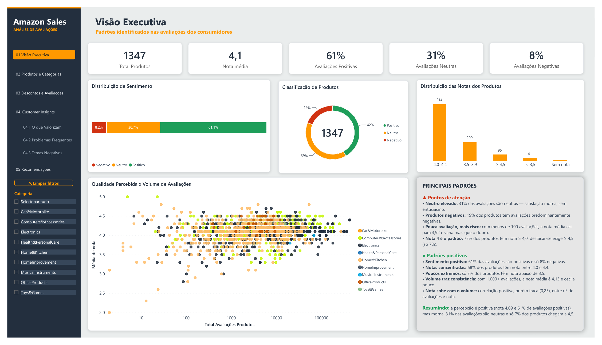
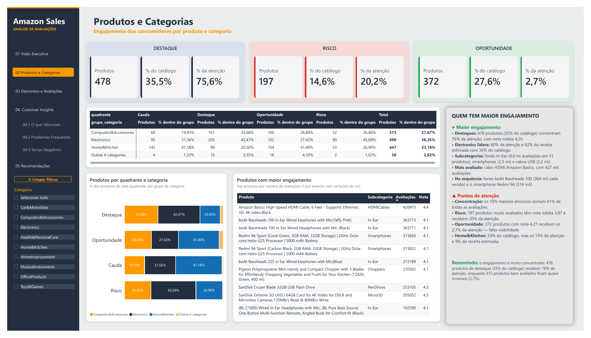
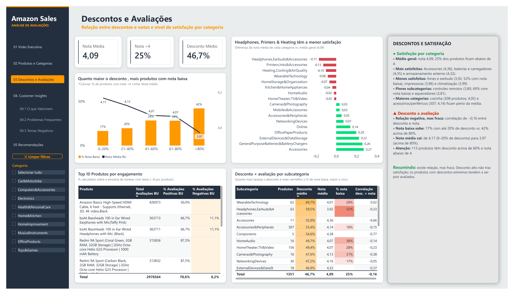
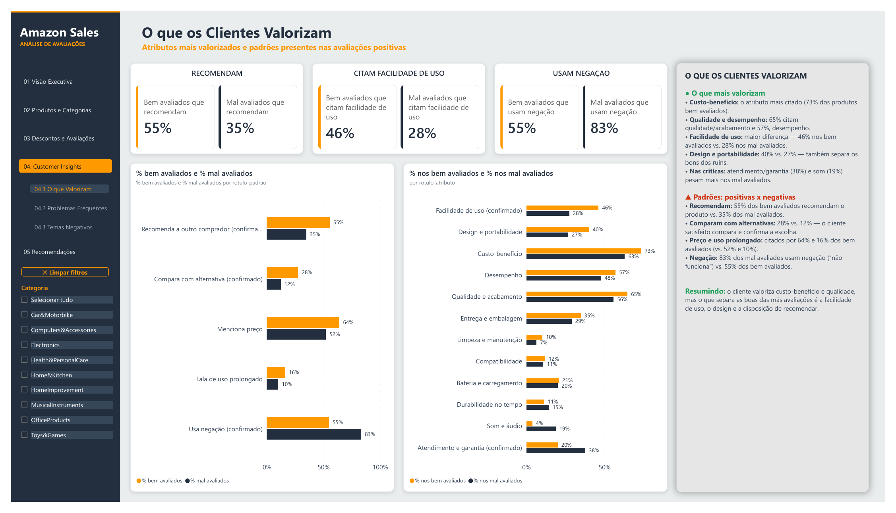
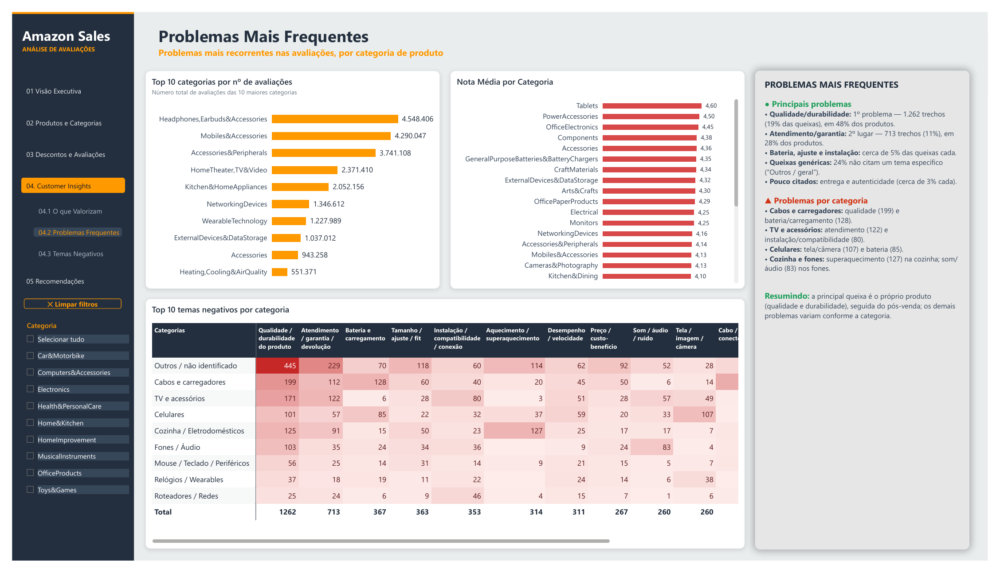
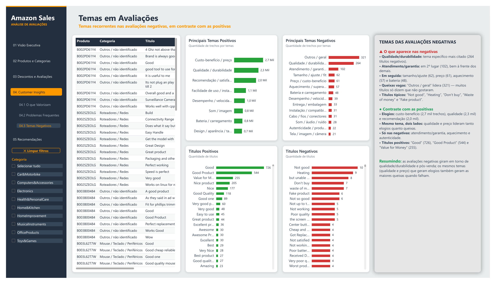
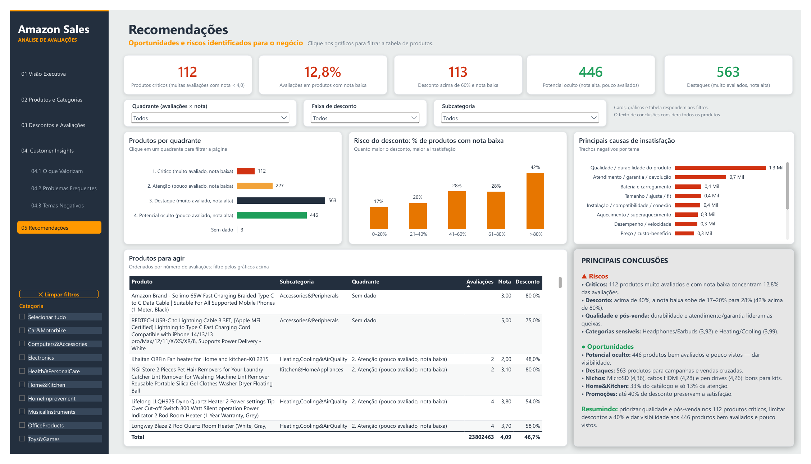

# 🛒 Amazon Product Performance & Customer Insights

**Tech Challenge – Fase 4 · FIAP Pós Tech Data Analytics · Analytical Solutions and Machine Learning Applied to Business**

Dashboard analítico em **Power BI** que investiga a relação **Preço → Desconto → Engajamento → Satisfação do Cliente** em um catálogo de produtos da Amazon. O objetivo é apoiar a liderança em decisões sobre portfólio, estratégia comercial e experiência do cliente.

> **Pergunta de negócio:** quais produtos, categorias e estratégias comerciais merecem maior atenção, e quais oportunidades podem ser identificadas a partir dos dados?

---

## 📦 Base de dados

- **Fonte:** [Amazon Sales Dataset – Kaggle](https://www.kaggle.com/datasets/karkavelrajaj/amazon-sales-dataset)
- **Conteúdo:** produtos, categorias, preço cheio e com desconto, % de desconto, nota, quantidade de avaliações, descrição e textos das avaliações (título e comentário)

## 📂 Estrutura do repositório

```
TC_FIAP-Fase4/
├── dashboard/
│   └── TCF4_BaseUnificadaV5.1.pbix                 # Dashboard Power BI (entregável)
├── data/
│   └── TechChallenge_F4_IMPORTAR_NO_POWERBI.xlsx   # Base tratada importada pelo Power BI (18 tabelas)
└── README.md
```

## 🔧 Preparação dos dados

A base original foi tratada e enriquecida antes de ir para o Power BI. O resultado é a planilha `data/TechChallenge_F4_IMPORTAR_NO_POWERBI.xlsx`, organizada em três grupos de tabelas:

| Grupo | Tabelas | Conteúdo |
|---|---|---|
| **Base unificada (BU)** | `BU_dProdutos`, `BU_dTema`, `BU_fFraseTema` | Dimensão de produtos (categoria nível 1 e folha, nota, avaliações, preço, desconto) e relação entre trechos de avaliações e temas |
| **Sentimento e temas (BR)** | `BR_Resumo_Sentimento`, `BR_Resumo_Categoria`, `BR_Temas_Positivos`, `BR_Temas_Negativos`, `BR_Temas_Negativos_Produto`, `BR_Trechos_Negativos`, `BR_Titulos_Sentimento`, `BR_Frases_Frequentes`, `BR_Classificacao_Produtos` | Classificação de sentimento (positivo, neutro, negativo), temas recorrentes e frases frequentes nas avaliações |
| **Atributos e engajamento (JO)** | `JO_P1_Atributos`, `JO_P1_Atributo_produto`, `JO_P3_Padroes`, `JO_P5_Categoria`, `JO_P5_Subcategoria`, `JO_P6_Engajamento` | Atributos citados por clientes (com intervalo de confiança de 95% e p-valor), padrões de linguagem e quadrantes de engajamento |

## 📐 Principais medidas (DAX)

- **Satisfação:** Nota Média, % Nota Baixa (nota < 4), Gap vs. Média geral, % Avaliações Positivas / Neutras / Negativas
- **Engajamento:** Total de Avaliações, Nº de Produtos, % do catálogo vs. % da atenção
- **Preço e desconto:** Desconto Médio, Correlação Desconto × Nota, Nº de produtos com desconto alto e nota baixa
- **Classificação de produtos (quadrantes avaliações × nota):** Nº Críticos, Nº Destaque, Nº Potencial Oculto, % Avaliações em Risco
- **Customer Insights:** % de bem e mal avaliados que recomendam, citam facilidade de uso ou usam negação, trechos negativos por tema

## 📊 Estrutura do dashboard

| Página | Conteúdo |
|---|---|
| **01 Visão Executiva** | Indicadores gerais, sentimento das avaliações e padrões de nota |
| **02 Produtos e Categorias** | Engajamento por produto e categoria, quadrantes (Crítico, Atenção, Destaque, Potencial oculto) |
| **03 Descontos e Avaliações** | Relação entre faixa de desconto e satisfação, risco por subcategoria |
| **04.1 O que os clientes valorizam** | Atributos mais citados e padrões das avaliações positivas vs. negativas |
| **04.2 Problemas mais frequentes** | Principais queixas e problemas por categoria |
| **04.3 Temas em avaliações** | Temas recorrentes nas avaliações negativas em contraste com as positivas |
| **05 Recomendações** | Oportunidades, riscos e tabela de produtos filtrável |

Todas as páginas têm filtros e interações cruzadas: clicar em um gráfico ou quadrante filtra os demais visuais da página.

## 🖼️ Telas do dashboard



<details>
<summary><b>Ver as demais páginas</b></summary>

### 02 Produtos e Categorias



### 03 Descontos e Avaliações



### 04.1 O que os clientes valorizam



### 04.2 Problemas mais frequentes



### 04.3 Temas em avaliações



### 05 Recomendações



</details>

## 💡 Principais insights

### Visão geral
- **Nota média 4,09** e **61% das avaliações positivas**, mas a satisfação é morna: **31% são neutras** e só **7% dos produtos** chegam a nota 4,5.
- Produtos com **menos de 100 avaliações** têm nota média menor (3,92) e mais instável.

### Produtos e engajamento
- O engajamento é concentrado: **478 produtos (35% do catálogo) recebem 76% da atenção**, e os 10% maiores anúncios somam 61% das avaliações.
- **Electronics** responde por 60% da atenção e 82% da receita estimada com 36% do catálogo.
- **Home&Kitchen** tem 33% do catálogo, mas só 13% da atenção.

### Descontos
- A relação entre desconto e nota é **negativa, mas fraca** (correlação −0,16).
- A proporção de produtos com nota baixa sobe de **17% (até 20% de desconto)** para **42% (acima de 80%)**.
- **113 produtos** têm desconto acima de 60% e nota abaixo de 4.

### Customer Insights
- **O que os clientes valorizam:** custo-benefício (73% dos bem avaliados), qualidade (65%) e desempenho (57%).
- **O que separa avaliações boas das ruins:** facilidade de uso (46% vs. 28%), design (40% vs. 27%) e disposição para recomendar (55% vs. 35%).
- **Principais queixas:** qualidade/durabilidade (19% das queixas, em 48% dos produtos) e atendimento/garantia (11%).
- Os problemas variam por categoria: bateria em cabos e celulares, superaquecimento na cozinha, áudio nos fones e instalação em TVs.

## 🎯 Recomendações

1. **Priorizar qualidade e pós-venda nos 112 produtos críticos**, que são muito avaliados, têm nota baixa e concentram 12,8% das avaliações.
2. **Limitar descontos a cerca de 40%.** Acima disso, a proporção de notas baixas sobe de 17–20% para 28%.
3. **Dar visibilidade aos 446 produtos de "potencial oculto"**, bem avaliados e pouco vistos.
4. **Usar os 563 produtos de destaque** em campanhas e vendas cruzadas.
5. **Montar kits com nichos bem avaliados**, como cartões MicroSD (4,36), cabos HDMI (4,28) e pen drives (4,26).
6. **Revisar categorias sensíveis**, como fones de ouvido (3,92) e climatização (3,99).

## 🚀 Como abrir

1. Instale o [Power BI Desktop](https://www.microsoft.com/pt-br/power-platform/products/power-bi/desktop) (gratuito, Windows).
2. Clone o repositório:
```bash
git clone https://github.com/ThiOliveira86/TC_FIAP-Fase4.git
```
3. Abra `dashboard/TCF4_BaseUnificadaV5.1.pbix`. Os dados já estão dentro do arquivo, então não é preciso reconectar a fonte para visualizar.

Para atualizar os dados, aponte a fonte do Power BI para `data/TechChallenge_F4_IMPORTAR_NO_POWERBI.xlsx` em *Transformar dados → Configurações da fonte de dados*.

## 🛠️ Ferramentas

Power BI Desktop · Power Query · DAX · Excel

---

**Tech Challenge – Fase 4 · FIAP Pós Tech Data Analytics · 2026**
